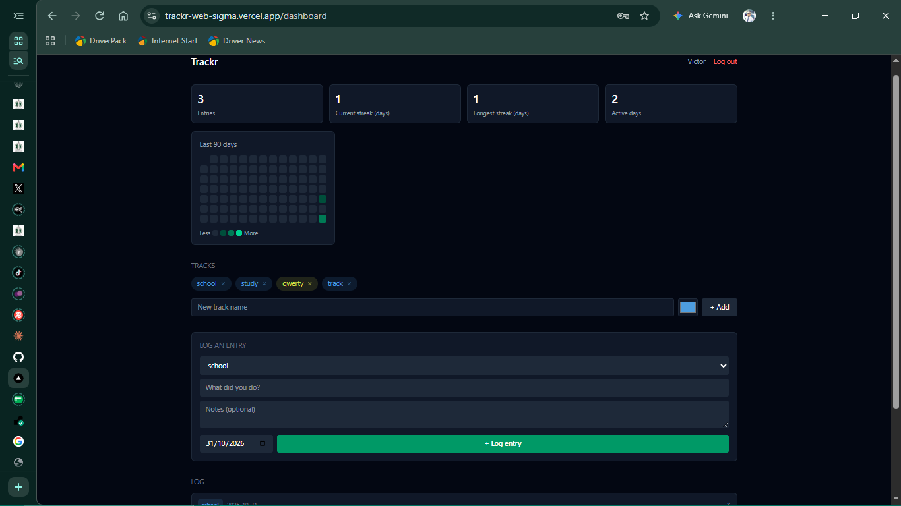

# Trackr

[](https://github.com/VeekAustin/trackr-web/actions/workflows/ci.yml)

A personal progress log. Create your own categories (teaching, dev work, forex trading, a course, anything) and log what you did under them, with a title, optional notes, and a date. Unlike a to-do app, Trackr records what you've already done, building a history of effort over time rather than a plan for later.

Live site: `https://trackr-web-sigma.vercel.app`
Backend repo: [trackr-api](https://github.com/VeekAustin/trackr-api)

## Features

- Landing page with an example log and track ideas for different kinds of work
- Sign up, then log in. Signup shows a confirmation on the login page rather than logging you in automatically
- Forgot password: request a reset link by email, then choose a new password from that link
- Sessions last 7 days, and an expired session sends you back to the login page
- Create your own tracks (name + color)
- Log dated entries against a track, including backfilling past days
- Delete a track or entry (deleting a track removes its entries too)
- Your data is private to your account
- Form validation with clear, field-level error messages
- Loading, empty, and error states on every screen
- Cached, auto-refetching data via React Query, so there is no manual reload after an action

## Tech stack

| Layer              | Choice                        |
| ------------------ | ----------------------------- |
| Framework          | Next.js (App Router)          |
| Language           | TypeScript                    |
| Styling            | Tailwind CSS v4               |
| Server state       | TanStack Query (React Query)  |
| Auth state         | React Context                 |
| Forms & validation | React Hook Form + Zod         |
| Testing            | Vitest, React Testing Library |
| Hosting            | Vercel                        |

## Project structure

```
src/
  app/
    page.tsx           # landing page (logged-in users go to /dashboard)
    dashboard/         # main authenticated view
    login/             # login page
    signup/            # signup page
    forgot-password/   # request a reset email
    reset-password/    # choose a new password from the emailed link
    components/        # UI components, ProtectedRoute, QueryProvider
    error.tsx          # global error boundary
  context/             # AuthContext
  hooks/               # useTracks, useEntries (React Query)
  lib/                 # apiFetch client, Zod schemas, track templates
```

## Getting started

```bash
git clone https://github.com/VeekAustin/trackr-web.git
cd trackr-web
npm install
```

Create a `.env.local` file:

```
NEXT_PUBLIC_API_URL=http://localhost:5000/api
```

Point this at a running [trackr-api](https://github.com/VeekAustin/trackr-api) instance, local or deployed.

Run it:

```bash
npm run dev     # dev server at localhost:3000
npm run build   # production build
npm start       # run the production build
npm test        # run the test suite
```

## Design notes

- **Forms use `noValidate`.** The browser's built-in validation would otherwise block submission before React Hook Form and Zod run, so every form pairs `zodResolver` with `noValidate`.
- **Pages that read the URL are wrapped in `Suspense`.** Pages using `useSearchParams` (the login success banner, the reset page) need it for the production build to pass.
- **One API client.** All requests go through `apiFetch`, which attaches the token, surfaces the server's error message, and logs the user out when an authenticated request returns 401.

## Testing

```bash
npm test
```

Covers:

- `LoginPage`: validation errors, successful login, server-error display
- `TrackForm`: submission, empty-input handling, input clearing, pending state

Auth and API calls are mocked in component tests, so the suite runs without a live backend.

## Deployment

Hosted on Vercel, auto-deploying from `main`. `NEXT_PUBLIC_API_URL` is set in Vercel's project settings and points at the deployed [trackr-api](https://github.com/VeekAustin/trackr-api) instance on Render.

The API runs on a free Render tier that spins down when idle, so the first request after a quiet period can take up to a minute.